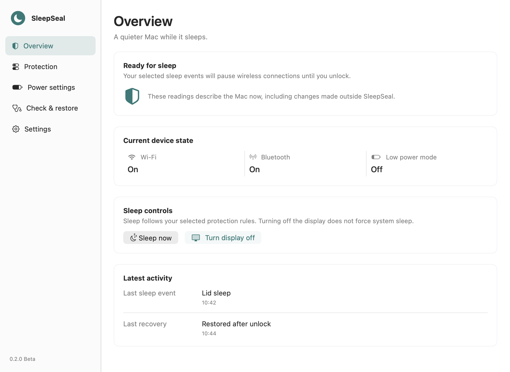

# SleepSeal

[](https://github.com/Pigyew/SleepSeal/actions/workflows/ci.yml)
[简体中文](README.zh-CN.md) · [Download 0.2.0 Beta](https://github.com/Pigyew/SleepSeal/releases/tag/v0.2.0) · [MIT license](LICENSE)

SleepSeal is a local macOS menu bar app that helps investigate and reduce unusual MacBook battery drain during sleep. At a protected system or display sleep, it saves the original settings, turns off Wi-Fi and Bluetooth, and enables the available Low Power Mode. It restores the saved settings after a real screen unlock is observed and the current console session is verified.

**0.2.0 is a Beta for Apple silicon Macs, with macOS 13 as the minimum deployment target.** It uses a temporary ad-hoc signature and is not Developer ID signed or notarized. A minimum target is not evidence of testing every macOS release. No overnight battery-saving claim or fixed percentage has been measured.



Dashboard preview using simulated device states.

## Install without Terminal

1. Download `SleepSeal-0.2.0-Beta-AppleSilicon.pkg` and its checksum from the [release](https://github.com/Pigyew/SleepSeal/releases/tag/v0.2.0).
2. Open the package and follow the normal macOS Installer. It requests administrator authorization to install the limited power-setting helper.
3. Open **SleepSeal** from Applications if its window does not appear automatically. Follow the setup guide, allow Bluetooth access, and confirm the protection choices. A new installation starts with **All methods** selected but does not enable protection before confirmation.
4. Use the SleepSeal menu bar icon to reopen the dashboard. Closing the window keeps protection running. Language options are **Follow system**, **简体中文**, and **English**.

macOS may block this unnotarized Beta. After checking the source and release checksum, use the normal **System Settings → Privacy & Security → Open Anyway** approval when macOS offers it. The package may also require approval. Do not disable Gatekeeper or SIP. See [Apple's guidance on opening apps](https://support.apple.com/guide/mac-help/open-a-mac-app-from-an-unknown-developer-mh40616/mac).

The package installs `/Applications/SleepSeal.app` and a root-owned helper. The app manages its own current-user login item, settings, and recovery files. Upgrades migrate the old user-level background service and preserve unfinished recovery; existing users retain their previous all-method protection. If migration or recovery cannot finish, the panel provides a retry path.

## Dashboard

| Page | What you can do |
|---|---|
| Overview | Check actual radio and power state, last trigger and recovery results; turn off the display or request sleep. |
| Protection | Choose all methods or a combination; inspect all four system Hot Corners. |
| Power settings | Set separate battery and plugged-in display/sleep timers and supported energy modes. |
| Diagnostics & recovery | Check access and sleep blockers, restore connections, export diagnostics locally. |
| Settings | Choose language and login behavior, pause protection, or uninstall safely. |

Missing Bluetooth permission or an unavailable helper does not remove the dashboard. Open Diagnostics & recovery to review the problem; reinstall the package when the power helper needs repair.

## Choose when protection applies

**All methods** covers every actual system/display sleep event, including events whose source cannot be identified. **Custom** enables independent choices, including any combination of these four methods:

| Method | How it is recognized |
|---|---|
| Manual sleep | Use **Sleep now** in the SleepSeal window or menu. A failed or unconfirmed sleep request does not turn off the radios. |
| Lid sleep | A recent lid-close state is associated with an actual system sleep. Working with the lid closed and an external display does not trigger protection by itself. |
| System Hot Corners | SleepSeal reads every corner's action and modifier keys. A recent entry into a configured **Put Display to Sleep** corner is associated with an actual display sleep. Select all configured sleep corners or specific corners. |
| Idle sleep | Actual idle system sleep, or display sleep associated with the configured inactivity timer. |

Hot Corner and display-idle classification is automatic correlation, not an exact macOS “source” field. Moving quickly is not required; leaving the pointer parked in a corner does not create a new trigger. The corner diagram reflects the current system settings, and **Open System Settings** lets you change them yourself. SleepSeal does not rewrite Hot Corner settings.

In Custom mode, an unknown or unselected source **keeps the connection unchanged** and the panel explains why protection was skipped. Apple menu → Sleep is covered by All methods; it is not advertised as a separately identifiable manual entry. A screen saver or screen lock alone is not sleep.

Rule edits apply to the next sleep cycle. They do not replace the original settings of a cycle that is already awaiting recovery.

## System power settings

These controls change **persistent macOS settings**. They remain in effect after SleepSeal quits. Opening the page reads the current values without applying defaults.

| Control | Battery and plugged in |
|---|---|
| Turn display off after inactivity | Independent times, Never, or a custom 1–1440 minutes. |
| Put system to sleep after inactivity | Independent times, Never, or a custom 1–1440 minutes. |
| Daily energy mode | Only modes verified as available; battery and adapter are independent. |
| Deep sleep time | **Managed by macOS** on the current Apple silicon implementation. |

**Apply changes** writes only edited fields, checks for external changes, and reads back the actual result. A conflict requires a refresh instead of overwriting newer system settings. An unusual existing timer value is preserved unless you edit it. Never is stored as `0`.

SleepSeal saves the values from before its first change separately from sleep-protection snapshots. **Restore original power settings** restores an app-written field only if it still matches SleepSeal's last saved value; later external changes are left alone. If a multi-field write fails, it attempts rollback and reports the observed result. Energy-mode editing is temporarily read-only while a protection or recovery cycle is pending; persistent timers remain separate and are not undone at unlock.

macOS power assertions can postpone automatic sleep. The diagnostics page shows applications that are preventing sleep; SleepSeal does not force-quit them or promise an exact countdown. See [Apple's sleep and wake settings guide](https://support.apple.com/guide/mac-help/set-sleep-and-wake-settings-mchle41a6ccd/mac).

Apple silicon has no verified Windows-style manual deep-hibernation timer in this project. SleepSeal does not offer a fake deep-sleep countdown or modify `hibernatemode` to claim one.

## Recovery, pause and uninstall

Only a newly observed screen unlock followed by verification of the current, unlocked console user authorizes automatic recovery. A lit lock screen, background wake, login check or ordinary “already unlocked” poll does not. Delayed session verification is retried for the same sleep cycle; a new sleep or lock invalidates an older unlock candidate.

Use **Restore connections** for explicit recovery in your unlocked session. Pause, quit and uninstall restore pending transient settings first. If recovery fails, the app retains its record and offers retry instead of deleting the information needed to recover. Uninstall preserves user-chosen persistent power timers by default; restoring the original power settings is a separate explicit choice. A shared installation is retained while another account still has a SleepSeal authorization rule.

Wi-Fi, Bluetooth and system energy settings are shared by Mac accounts. SleepSeal reserves an unfinished protection cycle for its original account rather than letting another account overwrite the snapshot. If a message says another account needs recovery, switch back to that account and restore it first. This reservation survives a restart; fast user switching and concurrent-account hardware behavior still need wider real-device testing.

For a first hardware check, save your work and keep the built-in keyboard, trackpad, Touch ID, or a wired input device available. Sleep briefly, wake to the lock screen, then unlock and check the recorded results. Repeat with a radio already off to confirm its original off state is retained. Real sleep and wireless tests affect the computer you are using.

## How it works and practical limits

One ordinary-user background process owns the menu, dashboard, event listeners, and serialized protection controller. System and display sleep notifications are merged into a cycle. The original Wi-Fi, Bluetooth and per-source energy/network settings are durably recorded before a change. Available `powernap`, `tcpkeepalive`, `womp`, and `proximitywake` settings are temporarily disabled too. Low Power Mode uses the current `powermode` key or the older `lowpowermode` key and retains the original mode, including an existing High Power Mode.

The process rechecks pending protection every 10 seconds when macOS lets it run. It cannot execute while the machine is asleep and cannot guarantee that firmware or system services never briefly re-enable hardware. Sleep preparation has a bounded operation budget and confirmation deadline. Partial failures retain recovery state. Local logs rotate at 1 MiB per file, retaining three files.

- Disabling Bluetooth and Wi-Fi prevents Apple Watch Auto Unlock and wireless input from being used to unlock. Use built-in or wired input.
- Offline sleep affects Find My availability, remote access, background sync, backups, and other network-dependent features.
- Set the system password requirement after display-off/screen-saver to **Immediately** if you want a consistent lock/unlock recovery path. If no lock occurs, use explicit recovery.
- Bluetooth power control and screen-lock verification depend partly on private macOS interfaces. System updates can change their behavior.
- Reopening the panel or restarting the app is not an unlock. An unfinished cycle may require a fresh lock/unlock or explicit recovery.
- Abnormal drain has many causes. This tool does not guarantee a particular battery saving or eliminate every wake.

## Security and privacy

Administrator authorization is handled by the graphical Installer. The root-owned helper at `/Library/PrivilegedHelperTools/local.sleepseal.PowerControl` accepts only a fixed operation, battery/adapter source, allowlisted key, and strictly validated integer. It launches `/usr/bin/pmset` with argument arrays. It accepts no arbitrary executable, file path, shell string or hibernation key. The current-user sudo rule grants this parser, not unrestricted `pmset` or `NOPASSWD: ALL`. Root authorization records are separate from user settings. There is no root background daemon.

Dashboard/control XPC requests require the same user and the designated code requirement of the current build. Merely sharing the bundle identifier or a process ID is insufficient. Read [Security](docs/SECURITY.md) and [Privacy](docs/PRIVACY.md) for the boundaries and local files.

SleepSeal has no account, telemetry service or cloud backend. The optional local diagnostic export contains only the app/OS version, protection status, radio/power states and permission readiness. It excludes raw logs, application blocker names and reasons, user paths, network identifiers and recovery snapshots. Review any file or screenshot before sharing, and do not attach your entire Application Support or Logs folder to a public issue.

## Build and verify

Developers need an Apple silicon Mac and Xcode or Command Line Tools. Ordinary users need neither Terminal nor Homebrew.

```sh
bash test.sh
bash build.sh
bash package.sh
```

Tests use simulated device adapters; they do not turn off real radios, change system power settings, or put the test machine to sleep. Coverage includes recovery gates and retries, event overlap, all trigger combinations, corner geometry/configuration/modifiers, persistent power conflicts and rollback, and helper argument rejection. UI verification uses simulated states. Rendering and native accessibility semantics do not constitute a completed manual VoiceOver audit.

CI builds on an ARM64 macOS 15 runner with the Xcode 16.4/macOS 15 SDK toolchain, checks signatures and package content, and creates an unsigned Beta installer artifact. Automated checks do not establish real-device compatibility on every OS version, external-display combination, or overnight battery behavior. The prototype's menu and lid paths were confirmed on one Apple silicon Mac; the expanded 0.2 paths need wider hardware testing.

See [Contributing](docs/CONTRIBUTING.md), [Changelog](docs/CHANGELOG.md), [snapshot provenance](docs/HISTORY.md), [UI behavior](docs/UX_CONTRACT.md), and [technical research](RESEARCH.md). Prototype archives were imported with truthful import dates; they are not represented as original historical Git commits.
