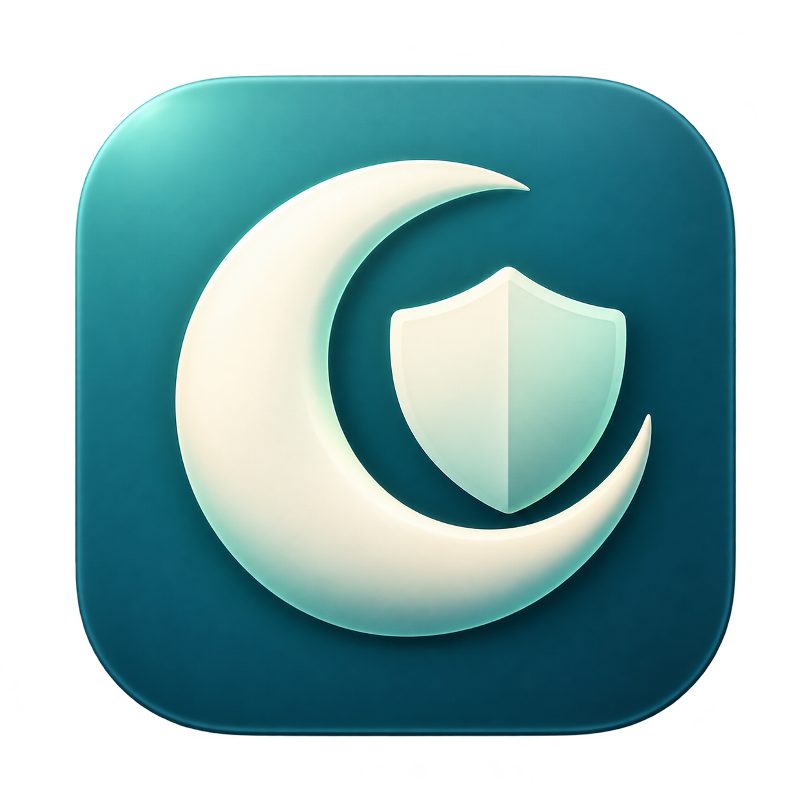
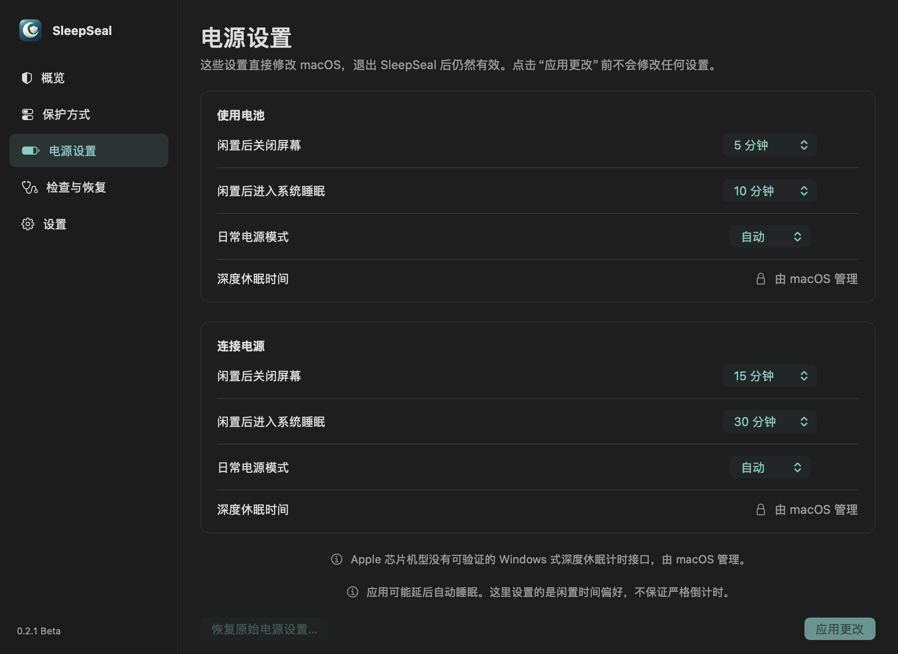

# SleepSeal 睡眠守护

当前开发目标为 **0.2.2 Beta**，改进恢复、卸载和后台运行可靠性。新标签发布前，下方公开下载仍指向 0.2.1。参见[改进与验证说明](docs/RELIABILITY.md)。

[](https://github.com/Pigyew/SleepSeal/actions/workflows/ci.yml)
[English](README.md) · [下载 0.2.1 Beta](https://github.com/Pigyew/SleepSeal/releases/tag/v0.2.1) · [MIT 许可](LICENSE)

SleepSeal 是一个本地运行的 macOS 菜单栏应用，目的是帮助排查、减少 MacBook 睡眠后异常耗电的问题。在需要保护的系统或显示器睡眠发生时，它先保存原始设置，再关闭 Wi-Fi、蓝牙，并开启设备可用的低电量模式。只有观察到真正的屏幕解锁并验证当前用户会话后，才自动恢复原来的设置。

**0.2.1 是面向 Apple 芯片 Mac 的 Beta，最低部署目标为 macOS 13。** 当前使用临时签名，尚无 Developer ID 正式签名或 Apple 公证。最低部署目标不代表已经逐一验证所有系统版本；目前也没有经过实测的过夜省电数据或固定节电百分比。



面板预览：使用模拟状态展示，不代表实测电源设置或节电效果。

## 无需 Terminal 安装

1. 从[发布页](https://github.com/Pigyew/SleepSeal/releases/tag/v0.2.1)下载 `SleepSeal-0.2.1-Beta-AppleSilicon.pkg` 及其校验值。
2. 双击安装包，按照 macOS 的正常安装窗口操作。安装器会请求管理员授权，用于安装权限受限的电源设置工具。
3. 如果窗口没有自动出现，从“应用程序”打开 **SleepSeal**。按照向导允许蓝牙权限，并确认保护方式。新安装会预选“全部方式”，但在你确认前不会启用保护。
4. 之后点击菜单栏中的 SleepSeal 图标即可重新打开面板；关闭窗口后仍会继续保护。语言可选“跟随系统／简体中文／English”。

macOS 可能拦截此尚未公证的 Beta。请先检查源码和发布校验值，再按照系统提供的“系统设置 → 隐私与安全性 → 仍要打开”流程批准。安装包本身也可能需要批准。无需关闭 Gatekeeper 或 SIP。可参考 [Apple 的打开应用说明](https://support.apple.com/zh-cn/guide/mac-help/mh40616/mac)。

安装位置为 `/Applications/SleepSeal.app`，电源工具由 root 拥有。登录启动项、配置与恢复记录由当前账户的普通用户进程管理。升级会迁移旧的用户后台服务并保留未完成的恢复记录；现有用户保留之前的全部方式保护。如果迁移或恢复未完成，面板会提供重试入口。

## 控制面板

| 页面 | 可进行的操作 |
|---|---|
| 概览 | 查看实际无线与电源状态、上次触发和恢复结果；立即关屏或请求睡眠。 |
| 保护方式 | 选择全部方式或自定义组合；查看系统四个触发角。 |
| 电源设置 | 分别设置电池与接电时的关屏、睡眠时间和支持的电源模式。 |
| 检查与恢复 | 检查权限与睡眠阻止原因，恢复连接，在本地导出诊断。 |
| 设置 | 选择语言、登录自启，暂停保护或安全卸载。 |

缺少蓝牙权限或电源工具不可用时，面板仍可打开。请在“检查与恢复”中查看原因；电源工具需要修复时，重新运行图形安装包。

左键点击菜单栏图标可打开面板，右键点击可打开快捷菜单。关闭面板后继续在后台保护。

## 选择哪些睡眠需要保护

**全部方式**覆盖所有实际系统／显示器睡眠，包括无法判断来源的事件。**自定义**支持以下四类独立选项，可选一个、多个、全部或一个也不选：

| 方式 | 判断依据 |
|---|---|
| 手动睡眠 | 使用 SleepSeal 面板或菜单栏中的“立即睡眠”。请求失败或未确认发生睡眠时，不关闭无线。 |
| 合盖睡眠 | 将近期合盖状态与实际系统睡眠关联；外接显示器下合盖继续工作，本身不会触发保护。 |
| 系统触发角 | 读取所有角的动作与修饰键，将近期进入“将显示器置于睡眠状态”的角与实际显示器睡眠关联；可选全部已配置的睡眠角或其中几个。 |
| 闲置自动睡眠 | 系统实际闲置睡眠，以及符合系统闲置时间设置的自动显示器睡眠。 |

触发角和显示器闲置来源属于自动关联识别，macOS 没有直接提供精确的来源字段。不要求鼠标速度；鼠标长期停在角落不会产生新的触发。四角示意图显示当前系统配置，可点击“打开系统设置”自行修改；SleepSeal 不会改写触发角设置。

自定义模式下，来源未知或未被选择时会**保持连接不变**，并在面板说明跳过原因。苹果菜单的“睡眠”由全部方式保护，不宣传为可单独精确识别的手动入口。锁屏或屏幕保护程序本身不等于睡眠。

修改规则影响下一轮睡眠，不会替换本轮正在等待恢复的原始设置。

## 直接设置 macOS 电源参数

这些控件修改的是**持久的 macOS 系统设置**，退出 SleepSeal 后仍然有效。初次打开页面只读取现值，不会套用默认时间。

| 控件 | 电池与接电分别设置 |
|---|---|
| 闲置后关闭屏幕 | 常用时间、永不，或自定义 1–1440 分钟。 |
| 闲置后进入系统睡眠 | 常用时间、永不，或自定义 1–1440 分钟。 |
| 日常电源模式 | 仅显示已确认可用的选项；两个电源来源独立。 |
| 深度休眠时间 | 当前 Apple 芯片实现显示“由 macOS 管理”。 |

“应用更改”只写入用户编辑的字段，保存前检查外部变化，写入后读回核验。发生冲突时需要刷新，不会用旧表单覆盖较新的系统设置。现有特殊时间值在你编辑前保持原样；“永不”对应 `0`。

SleepSeal 会把首次修改前的值与睡眠保护快照分开保存。“恢复原始电源设置”只恢复仍等于 SleepSeal 上次写入值的字段，用户之后在其他地方更改的值会保留。多个字段部分写入失败时，会尝试回滚并报告实际结果。保护或恢复尚未完成时，重叠的电源模式暂时只读；持久的关屏／睡眠时间独立管理，解锁不会撤销这些时间设置。

macOS 的电源断言可能推迟自动睡眠。“检查与恢复”会显示哪些应用正在阻止睡眠；SleepSeal 不会强杀应用，也不承诺严格倒计时。可参考 [Apple 电源设置说明](https://support.apple.com/zh-cn/guide/mac-help/mchle41a6ccd/mac)。

本项目尚未验证 Apple 芯片具有 Windows 式可手动设置的深度休眠计时能力，因此不提供虚假的深度睡眠倒计时，也不会通过修改 `hibernatemode` 来宣称实现。

## 可选：睡眠前请求退出阻止睡眠的应用

**“睡眠前请求退出阻止睡眠的应用”默认关闭**，升级后也不会自动开启。可在“检查与恢复”中打开，并阅读确认说明；确认窗口的默认键盘操作为“取消”。关闭此选项无需再次确认。

启用后，SleepSeal 只向**当前前台账户拥有、符合条件且阻止相关睡眠的普通应用**请求正常退出。系统服务和其他账户的应用会被排除。应用可以拒绝或显示保存提示；SleepSeal 不会强制退出、代替你关闭保存提示，也不会自动重新打开已经退出的应用。退出可能结束通话、停止下载或中断工作，请先保存工作再启用。

退出请求遵循同一组已选择的保护方式；自定义模式中未选的方式不会授权退出请求。使用 SleepSeal 自身的“立即睡眠”时，最多等待 **8 秒**；若符合条件的阻止项仍未退出、准备过程取消，或等待结束后仍未解决，就不会继续发出本次睡眠请求。闲置自动准备会检查相关的系统关屏／睡眠时间设置；电源断言与 macOS 调度仍会影响结果，并非严格倒计时。在实际选定的睡眠事件发生时，应用退出准备最多使用 **2 秒**，尽力而为，不会无限延迟睡眠或保证应用一定退出。

“检查与恢复”会显示已请求、已退出、仍在运行的数量，以及取消或超时状态。退出的应用需要你自行重新打开。请求前会在本机再次验证进程身份；不会保存应用身份清单，也不会将其加入诊断导出。

## 恢复、暂停与卸载

自动恢复需要先观察到新的屏幕解锁事件，再确认当前账户处于前台且未锁定。仅亮起锁屏、后台唤醒、登录检查或普通“已解锁”轮询都不能授权恢复。会话验证延迟时，会针对同一睡眠周期继续重试；新的睡眠或重新锁屏会让旧的解锁候选失效。

需要手动处理时，可在当前已解锁的会话中点击“恢复连接”。暂停、退出和卸载都会先恢复尚未完成的临时设置。恢复失败时保留记录和重试入口，不会删除恢复所需的信息。卸载默认保留用户保存的持久电源时间；恢复原始电源设置需要另外明确选择。其他账户仍有 SleepSeal 授权规则时，会保留共享应用和电源工具。

Wi-Fi、蓝牙和系统电源模式由 Mac 各账户共享。SleepSeal 会把未完成的保护周期保留给原账户，阻止其他账户覆盖原始快照。若提示另一账户需要恢复，请先切换回该账户完成恢复。此周期归属跨重启保留；快速用户切换及多账户同时登录的硬件行为仍需更广泛的实机测试。

首次实机测试前，请保存工作，并准备好内置键盘、触控板、Touch ID 或有线输入设备。短暂睡眠后唤醒并停留在锁屏，再解锁并检查记录；还可以测试睡眠前某个无线本来就关闭时，恢复后是否仍关闭。真实睡眠与无线测试会影响你正在使用的电脑。

## 原理与实际限制

一个普通用户后台进程统一拥有菜单栏、面板、事件监听和串行保护控制器。系统与显示器睡眠通知会合并为同一周期；在首次修改前，持久保存 Wi-Fi、蓝牙以及各电源来源的电源／网络设置。系统实际提供的 `powernap`、`tcpkeepalive`、`womp`、`proximitywake` 也会被临时关闭。低电量模式支持当前 `powermode` 与旧版 `lowpowermode`，并保留原值，包括原先的高性能模式。

存在待恢复周期时，只要 macOS 允许进程运行，就每 10 秒核对保护状态。电脑真正睡眠时程序无法执行，也不能保证固件或系统服务永远不会短暂重新启用硬件。睡眠准备具有操作预算与确认上限；部分失败会保留恢复记录。本地日志每份最多 1 MiB，保留三份。

- 关闭 Wi-Fi 和蓝牙后，不能依赖 Apple Watch 或无线键鼠解锁。请使用内置或有线输入设备。
- 离线睡眠会影响“查找”可用性、远程访问、后台同步、备份等网络功能。
- 建议将系统在关屏／屏幕保护后要求密码的时间设为“立即”，以获得一致的锁定与解锁恢复流程。没有发生锁定时可手动恢复。
- 蓝牙电源控制与锁屏验证部分依赖 macOS 私有接口，系统更新可能改变其行为。
- 重新打开面板或重启应用不等于解锁。未完成的周期可能需要再次锁定并解锁，或手动恢复。
- 异常耗电可能有多种原因；本工具不保证特定省电比例，也不能消除所有唤醒。

## 安全与隐私

管理员授权由图形安装器处理。root 拥有的工具位于 `/Library/PrivilegedHelperTools/local.sleepseal.PowerControl`，只接受固定操作、电池／接电来源、白名单设置键和严格验证的整数，通过参数数组调用 `/usr/bin/pmset`。它不接受任意程序、文件路径、shell 字符串或休眠参数。当前账户的 sudo 规则只授权此解析工具，不授予无限制的 `pmset` 或 `NOPASSWD: ALL`。root 授权记录与用户配置分开保存，没有 root 常驻后台进程。

面板控制请求通过 XPC 连接，要求相同用户及当前构建的指定代码签名条件。只有相同 Bundle ID 或进程号不足以通过验证。边界与本地文件说明见[安全](docs/SECURITY.md)及[隐私](docs/PRIVACY.md)。

SleepSeal 没有账户、遥测服务或云端后台。可选的本地诊断导出仅包含应用／系统版本、保护状态、无线／电源状态和权限是否就绪；不包含原始日志、阻止睡眠的应用名称及原因、用户路径、网络标识或恢复快照。分享任何文件或截图前仍请检查内容，不要把整个 Application Support 或 Logs 文件夹上传到公开 Issue。

## 构建与验证

开发者需要 Apple 芯片 Mac，以及 Xcode 或 Command Line Tools。普通用户不需要 Terminal 或 Homebrew。

```sh
bash test.sh
bash build.sh
bash package.sh
```

测试使用模拟设备适配器，不会关闭真实无线、修改系统电源设置或让测试电脑睡眠。覆盖恢复门槛和重试、事件重叠、所有触发组合、触发角几何／配置／修饰键、持久电源冲突与回滚，以及辅助工具的非法参数拒绝。界面验证使用模拟状态；渲染检查和原生辅助功能语义不代表完成了手工 VoiceOver 审核。

应用退出请求也使用模拟进程和应用检查，覆盖升级默认关闭、资格与身份验证、触发方式范围、取消／拒绝／超时及双语启用确认。开发测试不会请求真实应用退出。

CI 在 ARM64 macOS 15 环境使用 Xcode 16.4／macOS 15 SDK 构建，检查签名与安装包内容，并生成未正式签名的 Beta 安装产物。自动检查不能证明所有系统版本、外接显示器组合或过夜耗电均已实机验证。原型的菜单睡眠与合盖路径曾在一台 Apple 芯片 Mac 上确认生效；0.2 扩展路径仍需要更广泛的硬件验证。

更多信息：[贡献指南](docs/CONTRIBUTING.md)、[更新记录](docs/CHANGELOG.md)、[原型来源](docs/HISTORY.md)、[界面行为约定](docs/UX_CONTRACT.md)、[技术检索](RESEARCH.md)。原型 ZIP 按实际导入日期提交，不冒充原始历史 Git 提交。
